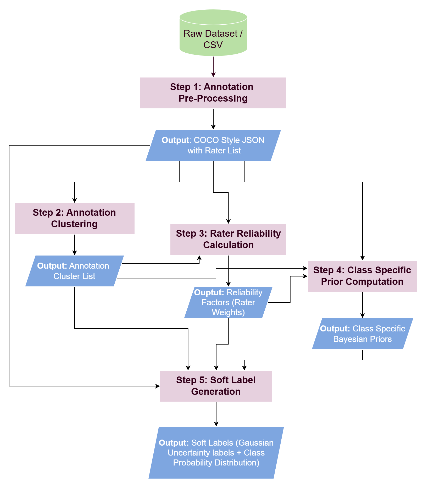

# Soft Label Object Detection

Uncertainty-aware object detection for multi-annotator medical imaging.

This repository has two linked parts:

1. `softlabel_generation`: turns multi-rater annotations into probabilistic (soft) labels
2. `object_detection`: trains detectors on those (soft) labels

The main use case is chest X-ray pathology detection on VinDr-CXR, but the code is structured so new datasets, clustering methods, and model components can be added with limited changes.

## Overview

Many medical images have valid disagreement (both, regional and semantic) between experts. This repository proposes a Deep-Learning framework to embrace these disagreements instead of collapsing it into one aggregated hard target.

The pipeline has two stages:

1. **Soft label generation**
   - groups annotations into finding clusters
   - weights annotators by agreement
   - estimates spatial uncertainty and class probabilities
   - exports canonical hard or soft label files

2. **Probabilistic object detection**
   - trains Faster R-CNN on those label files
   - predicts boxes, class distributions, and uncertainty parameters
   - supports hard labels, 1D soft labels, and 2D soft labels

<details>
<summary><strong>Core ideas</strong></summary>

- **Soft labels**: each finding can carry a class distribution instead of one class
- **Spatial uncertainty**: each finding can carry uncertainty over box parameters
- **Reliability weighting**: annotators can contribute with different weights
- **Dataset modularity**: datasets are selected from config and built through a registry
- **Image-level splitting**: train/validation splitting is deterministic and leakage-safe

</details>

<details>
<summary><strong>Main outputs</strong></summary>

**From `softlabel_generation`:**
- reliability CSVs
- Bayesian class priors
- canonical hard label JSON
- canonical soft label JSON

**From `object_detection`:**
- trained detection checkpoints
- training logs
- evaluation reports

</details>

## Installation Guide

### Requirements

- Python `>= 3.10`
- PyTorch `>= 2.0`
- CUDA is recommended for training

### Install

```bash
(setting up a virtual environment highly recommended)
git clone <repository-url>
cd softlabel_object_detection
pip install -e .
```

### Quick Start

#### 1. Prepare your data

Write a pre-pipeline ingestion script (or use an existing one from `src/softlabel_od/scripts/`) to convert your dataset into the canonical CSV format.
<details>
<summary>Canonical CSV Format</summary>

<strong>Columns: </strong>`image_id`, `rad_id`, `class_name`, `class_id`, `x_min`, `y_min`, `x_max`, `y_max`, `width`, `height`

</details>
Place your raw data and set output paths in a YAML config under `configs/softlabel_pipeline/`.

#### 2. Generate soft labels

```bash
python -m softlabel_od.scripts.run_pipeline --config configs/softlabel_pipeline/<your_dataset>.yaml
```

#### 3. Train a detector

```bash
python -m softlabel_od.scripts.train --config configs/<YOUR-CONFIG>.yaml
```

#### 4. Evaluate a model

```bash
python -m softlabel_od.scripts.evaluate --weights outputs/saved_models/model.pth --gmm_type 1D
```

<details>
<summary><strong>Quick start notes</strong></summary>

- Use `--gmm_type HARD_LABEL` to evaluate a deterministic model trained on Hard-Labels
- Use `python -m softlabel_od.scripts.train_lightning --config ...` for the Pytorch Lightning path
- Config files are user-specific by design. Each contributor can keep local dataset paths in their own YAML files

</details>

## Sub-Package Information

### `softlabel_generation`

Builds probabilistic labels from multi-annotator annotations.

**What it does**
- normalizes raw annotations
- converts them into a common intermediate format
- computes annotator agreement
- clusters overlapping findings
- produces hard or soft label files

<details>
<summary><strong>Structure</strong></summary>

- `core/preprocessing/`
  - CSV normalization
  - CSV to JSON conversion
  - optional data prep helpers

- `core/reliability/`
  - pairwise agreement
  - annotator weighting

- `core/label_assembly/`
  - priors
  - hard label construction
  - 1D and 2D soft label construction

- `ports/`
  - correspondence and clustering interfaces
  - `DatasetPreprocessingAdapter` — abstract contract for CSV normalization

- `adapters/datasets/`
  - dataset-specific preprocessing adapters
  - adapter registry (maps dataset name → adapter class)

- `utils/`
  - clustering helpers
  - overlap metrics
  - analysis tools

</details>

<details>
<summary><strong>Important concepts</strong></summary>

- **Placeholder background box**: background-only findings use a normalized full-image placeholder such as `[0, 0, 1, 1]`
- **Clustering methods**: IoU, IoMin, IoMin with center-distance gating
- **Priors**: class-specific uncertainty (bayesian) priors stabilize sparse cases
- **1D vs 2D**:
  - `1D`: diagonal uncertainty over box parameters
  - `2D`: covariance over box vertices

</details>

<details>
<summary><strong>Output Label format (JSON)</strong></summary>

<details>
<summary>1D Soft label</summary>

```json
{
  "image_id": "...",
  "image_width": 1024,
  "image_height": 1024,
  "finding_id": 0,
  "original_annotations": [ ... ],
  "spatial": {
    "mean": [x_mean, y_mean, w_mean, h_mean],
    "std": [x_std, y_std, w_std, h_std]
  },
  "prior_used": "Atelectasis",
  "class_probs": { "Atelectasis": 0.7, "NoFindingInCluster": 0.3 },
  "num_annotations_in_cluster": 2
}
```
</details>

<details>
<summary>Hard label (No-Finding Instance)</summary>

```json
{
    'image_id': "...",
    'image_width': 1024,
    'image_height': 1024,
    'finding_id': 1,
    'original_annotations':[...],
    'bbox': [0.0, 0.0, 1.0, 1.0],
    'class': 'No Finding',
    'confidence': 1.0,
    'extraction_method': 'true_no_finding',
    'original_class_probs': {...},
    'renormalized_class_probs': {'No finding': 1.0},
    'num_annotations': 3
}
```
</details>

<details>
<summary>Hard label (Pathology Instance)</summary>

```json
{
    'image_id': "...",
    'image_width': 1024,
    'image_height': 1024,
    'finding_id': 0,
    'original_annotations': [...],
    'bbox': [x_mean, y_mean, w_mean, h_mean],
    'class': Aortic Enlargement,
    'confidence': 0.668,
    'extraction_method': 'majority_pathology',
    'original_class_probs': { "Aortic Enlargement": 0.668, "NoFindingInCluster": 0.332 },
    'renormalized_class_probs': {"Aortic Enlargement": 0.668},
    'num_annotations': 3
}
```
</details>
Coordinates normalized to [0, 1].
</details>  

<details>
<summary> Soft Label generation Pipeline Flow Diagram </summary>


</details>


### `object_detection`

Trains and evaluates detectors on canonical hard or soft labels.

**What it does**
- loads canonical label files
- builds deterministic train/validation splits
- trains Faster R-CNN variants
- supports probabilistic heads and standard hard-label baselines
- evaluates both standard and soft-label metrics

<details>
<summary><strong>Structure</strong></summary>

- `core/model/`
  - model factory
  - backbone selection
  - detector construction

- `core/training/`
  - training loops for hard, 1D, and 2D modes

- `core/evaluation/`
  - mAP
  - IoU
  - soft-label metrics
  - uncertainty metrics

- `core/datasets/`
  - shared canonical dataset base
  - shared dataset utilities

- `ports/`
  - dataset runtime contract

- `adapters/datasets/`
  - dataset adapters
  - dataset registry and factory

- `adapters/model_components/`
  - probabilistic ROI heads
  - custom model pieces

- `adapters/lightning/`
  - Lightning wrappers

- `utils/`
  - losses
  - schedulers
  - config loading
  - augmentations
  - samplers

</details>


<details>
<summary><strong>Important concepts</strong></summary>

- **Training modes** : `hard`, `soft_1D`, `soft_2D` (experimental)

- **Standard metrics** : mAP, avg_IoU, class_accuracy

- **Soft-label metrics**
  - top-k accuracy
  - JS divergence & KL-Divergence- measure for 'Class Probability Distribution' allignment

- **Uncertainty metrics**
  - expected IoU- measure for regression uncertainty allignment (Standard Deviation and Variances)
  - calibration-oriented error summaries

</details>

### Main callable scripts

These are the main entry points most users will call.

<details>
<summary><strong>Scripts</strong></summary>

- `softlabel_od.scripts.run_pipeline`
  - end-to-end soft label generation pipeline

- `softlabel_od.scripts.train`
  - vanilla PyTorch training

- `softlabel_od.scripts.train_lightning`
  - Lightning training path

- `softlabel_od.scripts.evaluate`
  - model evaluation

</details>

## Command Line Interface

Installed commands:

```bash
softlabel-pipeline
softlabel-train
softlabel-train-lightning
softlabel-evaluate
```

Equivalent module calls:

```bash
python -m softlabel_od.scripts.run_pipeline --config configs/softlabel_pipeline/<dataset>.yaml
python -m softlabel_od.scripts.train --config configs/<your-training-config>.yaml
python -m softlabel_od.scripts.train_lightning --config configs/<your-training-config>.yaml
python -m softlabel_od.scripts.evaluate --weights outputs/saved_models/<model-weights>.pth --gmm_type 1D
```

<details>
<summary><strong>Common pipeline options</strong></summary>

All pipeline parameters (`gmm_mode`, `clustering_method`, thresholds, etc.) live in the dataset YAML config. The CLI only exposes three flags:

```bash
# Run the full pipeline for a dataset
python -m softlabel_od.scripts.run_pipeline --config configs/softlabel_pipeline/<dataset>.yaml

# Run specific steps only (e.g. reliability onwards)
python -m softlabel_od.scripts.run_pipeline --config configs/softlabel_pipeline/<dataset>.yaml --steps 3 4 5

# Preview commands without executing
python -m softlabel_od.scripts.run_pipeline --config configs/softlabel_pipeline/<dataset>.yaml --dry-run
```

</details>

## Extension Guide

### Add a new dataset

Dataset extension is now config-driven on the object detection side.

**Object detection workflow**
[Dataset Rule Book](src/softlabel_od/object_detection/DATASET_RULEBOOK.md)

**Soft label generation workflow**

1. **Write an ingestion script** in `src/softlabel_od/scripts/` to convert your raw data into the canonical CSV format (columns: `image_id`, `rad_id`, `class_name`, `class_id`, `x_min`, `y_min`, `x_max`, `y_max`, `width`, `height`). Optionally also produce the COCO JSON required by Step 3.

2. **Create an adapter** in `src/softlabel_od/softlabel_generation/adapters/datasets/<yourdata>.py`. Subclass `DatasetPreprocessingAdapter` for custom normalization logic, or `NullAdapter` if your ingestion script already outputs normalized `[0, 1]` coordinates.

3. **Register the adapter** in `adapters/datasets/__init__.py`:
   ```python
   from softlabel_od.softlabel_generation.adapters.datasets.yourdata import YourDataAdapter
   register_adapter("yourdata", YourDataAdapter)
   ```

4. **Add a config** at `configs/softlabel_pipeline/<yourdata>.yaml`:
   ```yaml
   DATASET:
     name: "yourdata"
     no_finding_labels: []        # list label strings that mean "no finding", or leave empty
     absent_rater_vote: false     # true if unannotated images count as a "no finding" vote
     image_id_key: "file_name"    # "file_name" (strip extension) or "id" (COCO integer id)

   PIPELINE:
     gmm_mode: "1d"               # "1d" or "2d"
     clustering_method: "iou"     # "iou", "iomin", or "iomin_center_gate"
     iou_threshold: 0.5
     iomin_threshold: 0.5
     center_ratio_threshold: 0.5
     iou_reliability: 0.5
     prior_alpha: 1.0
     min_samples: 5
     semantic_map: null           # registered semantic map name, or null for none
     reliability_backend: "kalos"
     reliability_method: "shm"

   PATHS:
     input_csv: "outputs/yourdata/train_enriched.csv"
     output_dir: "outputs/yourdata"
     reliability_dir: "outputs/raters_reliability/yourdata"
   ```

5. **Run the pipeline**, skipping steps already handled by your ingestion script:

   | What your ingestion script produces | Steps to run |
   |-------------------------------------|--------------|
   | Canonical CSV with pixel-coordinate bboxes | `1 2 3 4 5` (default) |
   | Canonical CSV with normalized `[0, 1]` bboxes | `2 3 4 5` |
   | Canonical CSV + COCO JSON, both normalized | `3 4 5` |

   ```bash
   # Full pipeline
   python -m softlabel_od.scripts.run_pipeline --config configs/softlabel_pipeline/yourdata.yaml

   # Skip normalization and COCO conversion (CSV + JSON already prepared)
   python -m softlabel_od.scripts.run_pipeline --config configs/softlabel_pipeline/yourdata.yaml --steps 3 4 5
   ```

<details>
<summary><strong>Object detection dataset config example</strong></summary>

```yaml
DATA:
  DATASET: "vindrcxr"
  ROOT: "/path/to/images"
  LABEL_MODE: "soft_1d"
  LABEL_FILE: "/path/to/labels.json"

  OPTIONS:
    image_subdir: "train"
    image_extension: ".png"
    rater_weights_csv: "/path/to/rater_weights.csv"
```

</details>

<details>
<summary><strong>Object detection dataset rules</strong></summary>

A dataset adapter must satisfy the runtime contract in:

- `src/softlabel_od/object_detection/ports/dataset_port.py`

The detailed dataset rules are in:

- `src/softlabel_od/object_detection/DATASET_RULEBOOK.md`

Key points:
- splits happen at the image level
- `__getitem__` must return the standard target fields
- canonical label modes are `hard`, `soft_1d`, `soft_2d`
- placeholder full-image boxes are treated as background-only findings
- new adapters should not require changes to training or evaluation code

</details>

### Add a new clustering method

Extend:

- `src/softlabel_od/softlabel_generation/ports/correspondence.py`

Typical work:
- define the overlap rule
- implement the grouping logic
- keep the one-rater-per-cluster constraint if required

### Add a new loss function

Extend:

- `src/softlabel_od/object_detection/utils/losses.py`

Typical work:
- add the loss
- wire it into the training path that uses it
- document how it applies to hard or soft training modes

### Add a new evaluation metric

Extend:

- `src/softlabel_od/object_detection/core/evaluation/metrics.py`

Typical work:
- compute the metric from predictions and targets
- add it to the reporting path
- keep it consistent across train/validation use if needed

## Repository Structure

<details>
<summary><strong>Tree</strong></summary>

```text
src/softlabel_od/
├── softlabel_generation/
│   ├── core/
│   ├── ports/
│   ├── adapters/
│   └── utils/
├── object_detection/
│   ├── core/
│   ├── ports/
│   ├── adapters/
│   └── utils/
├── shared/
│   └── utils/
└── scripts/
```

</details>

## Citation

```bibtex
@inproceedings{
ognawala2026learning,
title={Learning from Disagreement},
author={Haaroon Afroz Ognawala and David Tschirschwitz and Claudio Jung and Volker Rodehorst},
booktitle={Second Workshop on Curated Data for Efficient Learning},
year={2026},
url={https://openreview.net/forum?id=UDF9tTy7je}
}
```

## Acknowledgments

This repository builds on ideas from:
- probabilistic object detection
- Faster R-CNN style detection
- multi-annotator learning
- Krippendorff's Alpha
- multilabel iterative stratification